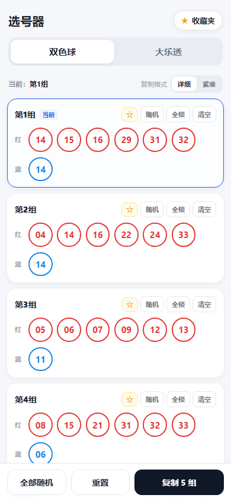
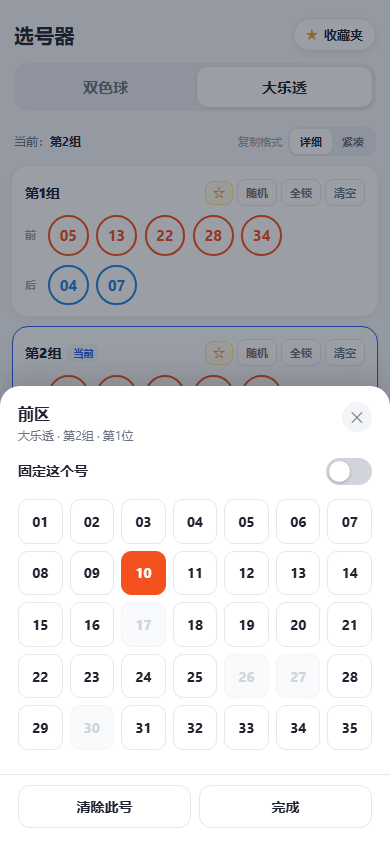
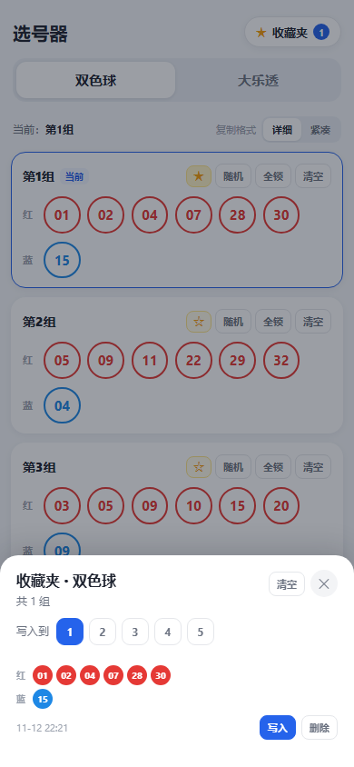

# 双色球 / 大乐透 选号器

一个纯前端、单文件的选号小工具。只有**双色球**和**大乐透**两个模式，每个模式固定 **5 组**号码。每个号码都能单独改、单独固定；随机时只替换没有固定的号码，抽完仍按升序排列；最后可一键复制成文本。



## 功能

- **双色球**：红球 6 个（1–33）+ 蓝球 1 个（1–16）
- **大乐透**：前区 5 个（1–35）+ 后区 2 个（1–12）
- 两个模式各 5 组，切换时各自保留，互不影响
- **改号**：点任意号码弹出数字面板；同区已用数字置灰，点数字即选中
- **固定**：
  - 长按号码；
  - 或点开号码后打开「固定这个号」；
  - 每组还有「全锁 / 全解锁」一键切换；
  - 已固定的号码右上角会显示一枚小锁（只是状态标记，不用点它）
- **随机**：只重抽未固定的号码，固定号原样保留；抽完自动升序
- **收藏夹**：收藏某一组号码，一键写入当前组（写入后全部变为未固定）
- **复制**：详细 / 紧凑两种格式；有空位时自动随机补全再复制，提示条里可以「撤销」
- **自动保存**：号码、固定状态、收藏都保存在浏览器 localStorage
- 浅色主题，手机 / 桌面均可用，**无任何网络请求**
- 键盘可用：数字面板里 Tab 不会跑出弹层，Esc 关闭；改完号焦点会留在原处

### 界面

| 大乐透选号 | 收藏夹 |
| --- | --- |
|  |  |

## 使用

直接双击 `index.html`，或部署后手机浏览器打开。

1. 顶部选「双色球 / 大乐透」
2. 点任意号码改号；长按号码（或打开号码后拨动「固定这个号」）来固定
3. 点「随机」只补未固定的；点「全部随机」一次生成 5 组
4. 满意的组点 ☆ 收藏；收藏夹里选目标组，点「写入」
5. 点「复制 5 组」，得到文本

### 复制格式

详细：

```text
双色球 5注
1. 红 01 05 12 18 23 30 + 蓝 07
2. 红 03 09 14 20 27 32 + 蓝 11
...
```

紧凑：

```text
01 05 12 18 23 30+07
03 09 14 20 27 32+11
...
```

大乐透对应为 `前 ... + 后 ...` 和 `...+...`。

## 手机端使用

手机浏览器打开：

<https://xuanloyer.github.io/lottery-picker/>

### 添加到主屏幕

- iPhone / Safari：点底部「分享」→「添加到主屏幕」
- Android / Chrome：点右上角菜单 →「添加到主屏幕」或「安装应用」

之后从桌面图标进入，全屏运行，和 App 一样。

### 触屏操作

- 点号码：改号
- 长按号码：固定 / 取消固定
- 点「随机」：只补未固定的号码
- 点「复制 5 组」：复制文本，可直接粘贴到微信

> 号码和收藏只保存在这台手机的浏览器里，换手机或清缓存会丢。

## 兼容性

用到了 `clamp()`、`aspect-ratio`、`inset` 等现代 CSS，以及 `Element.closest`、`Set` 等 API，需要 2020 年之后的浏览器（Chrome / Edge 88+、iOS 15+、新版 Firefox / Safari）。不支持 IE。

## 项目结构

```text
.
├── index.html            # 应用本体（HTML/CSS/JS 全在一个文件里）
├── favicon.svg           # 浏览器标签图标
├── apple-touch-icon.png  # iOS 添加到主屏幕的图标
├── screenshots/          # README 用的界面截图
├── README.md
├── LICENSE
└── .gitignore
```

## 数据说明

- 所有号码只存在当前浏览器的 `localStorage`（键名 `lottery-picker-v1`），不会上传。
- 换浏览器、清缓存、无痕模式会丢数据。
- 页面没有任何外部请求，断网也能用。

## 自定义

- 号码范围、每区个数：改 `index.html` 里的 `MODES` 配置。
- 组数：改 `GROUP_COUNT`，按钮文案和复制出来的文本会自动跟随。
- 主题色：改 CSS 变量 `--red` / `--blue` / `--orange` / `--accent` 等。
- 标题、提示文案、免责声明：直接在 HTML 里改。

## 免责声明

号码由本地随机生成，仅供娱乐参考，不构成任何购彩建议。请理性购彩。

## 许可证

[MIT License](LICENSE)。如果这是你的个人项目，可以把 `LICENSE` 里的版权人改成你自己的名字。
